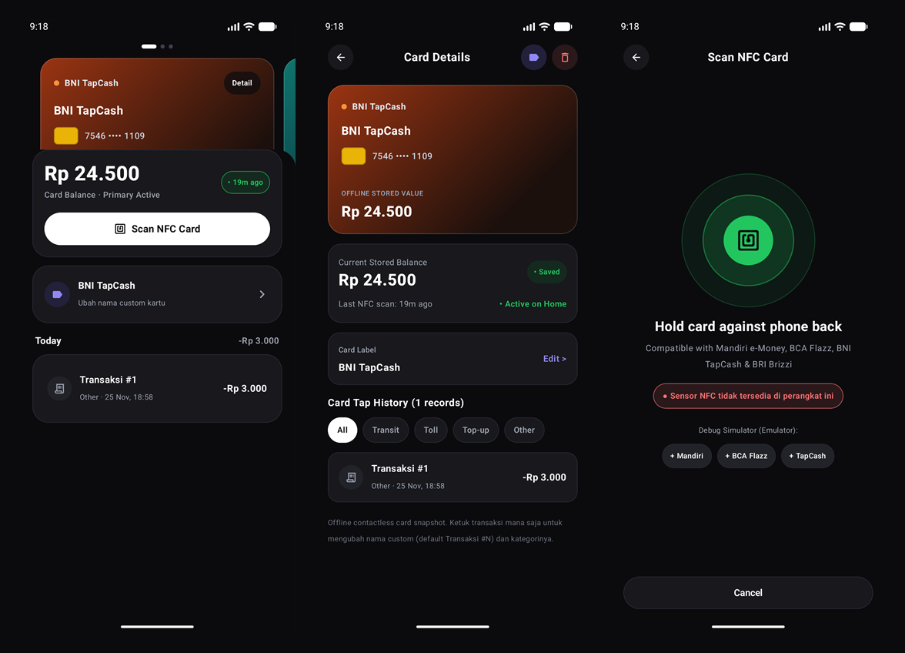

# TapSaldo — NFC E-Money Card Reader

Aplikasi Android pembaca kartu e-money berbasis **NFC (`IsoDep` APDU)** yang **100% offline-first**. TapSaldo tidak hanya membaca sisa saldo saat kartu ditempel, tetapi juga menyimpan dan menggabungkan riwayat transaksi secara lokal di perangkat agar catatan lama tidak hilang ketika memori chip kartu fisik tertimpa.

---

## Tampilan Aplikasi



*Kiri ke kanan: Halaman Utama (Swipeable Card & Bubbles) · Card Details & Tap History · Scan NFC Card*

---

## Fitur Utama

- **Multi-Card Swipeable Pocket:** Geser kartu secara horizontal di halaman utama untuk berpindah antar kartu tersimpan dan langsung melihat saldo serta riwayat transaksi masing-masing kartu.
- **Custom Card Label:** Beri nama custom pada setiap kartu (mis. *Daily Commute Card*, *Highway Toll Pass*) dengan saran cepat atau input bebas.
- **Pengingat & Deduplikasi Transaksi Lokal:** Chip kartu e-money umumnya hanya menyimpan saldo terakhir dan beberapa transaksi terbaru. TapSaldo menyimpan seluruh riwayat ke database lokal (**Room**) dengan deduplikasi otomatis serta *fallback* selisih saldo (`BALANCE_DELTA`) bila chip tidak menyediakan log transaksi mentah.
- **Custom Nama & Kategori Transaksi:** Transaksi baru otomatis dinamai `Transaksi #1`, `Transaksi #2`, dst., dan dapat di-tap kapan saja untuk diubah nama custom serta kategorinya (`Transit`, `Toll`, `Top-up`, `Other`).
- **Auto-Scan & Konfirmasi Kartu Aktif:** Mendukung pembacaan otomatis saat aplikasi terbuka di *foreground* (dijeda sementara ketika modal edit terbuka) serta tombol **Confirm & Set as Active** saat memindai kartu berbeda.
- **Hapus Kartu:** Menghapus kartu tersimpan beserta seluruh riwayatnya (`CASCADE`) dari halaman *Card Details*.

---

## Kartu yang Didukung

Arsitektur parser NFC (`EmoneyParser`) dibangun modular untuk kartu berbasis `IsoDep`:
- **Mandiri e-Money**
- **BCA Flazz** (Gen 2)
- **BNI TapCash**
- **BRI Brizzi**

*(Kartu yang saldonya terenkripsi penuh secara offline atau bukan kartu e-money yang kompatibel akan ditolak dengan pesan error tanpa mengotori daftar kartu tersimpan.)*

---

## Tech Stack

- **Bahasa & Build:** Kotlin, Android Gradle Plugin `9.5.2`, `minSdk = 24`, `targetSdk = 37`
- **UI:** Jetpack Compose (Material 3), Navigation Compose, Edge-to-Edge
- **Penyimpanan Lokal:** Room Database + KSP, Kotlin Coroutines & Flow
- **NFC:** Android `NfcAdapter.enableReaderMode` (`IsoDep` APDU)
- **Testing:** JUnit4, `kotlinx-coroutines-test`

---

## Cara Menjalankan & Menguji

1. Buka proyek di **Android Studio** dan tunggu proses **Gradle Sync** selesai.
2. Jalankan di perangkat Android ber-NFC (disarankan untuk mengetes tap kartu fisik) atau di **Android Emulator** (di mode *Debug*, tersedia tombol **Debug Simulator** di layar *Scan NFC Card* untuk menguji alur kartu Mandiri, BCA Flazz, dan BNI TapCash).
3. Menjalankan unit test & build APK debug via terminal:
   ```bash
   ./gradlew testDebugUnitTest assembleDebug
   ```
